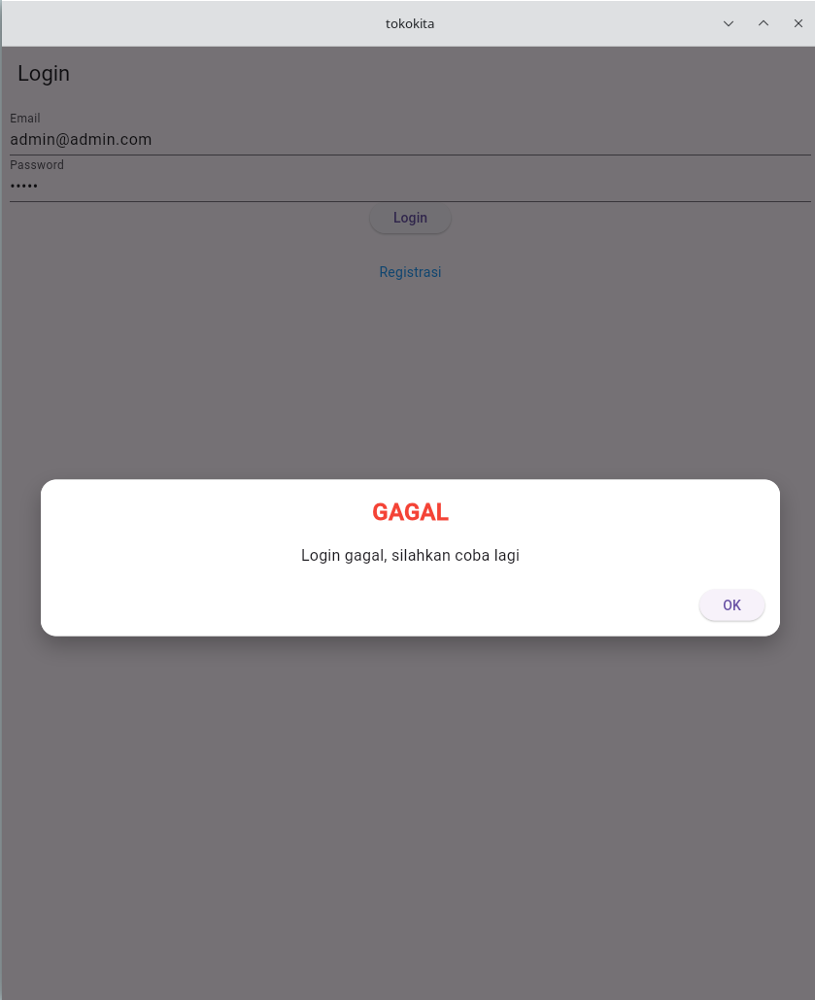
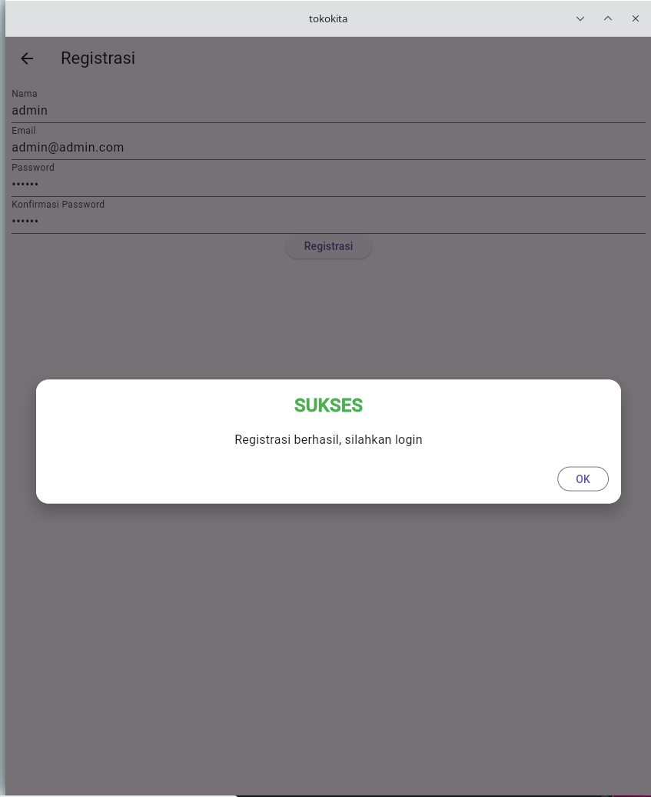
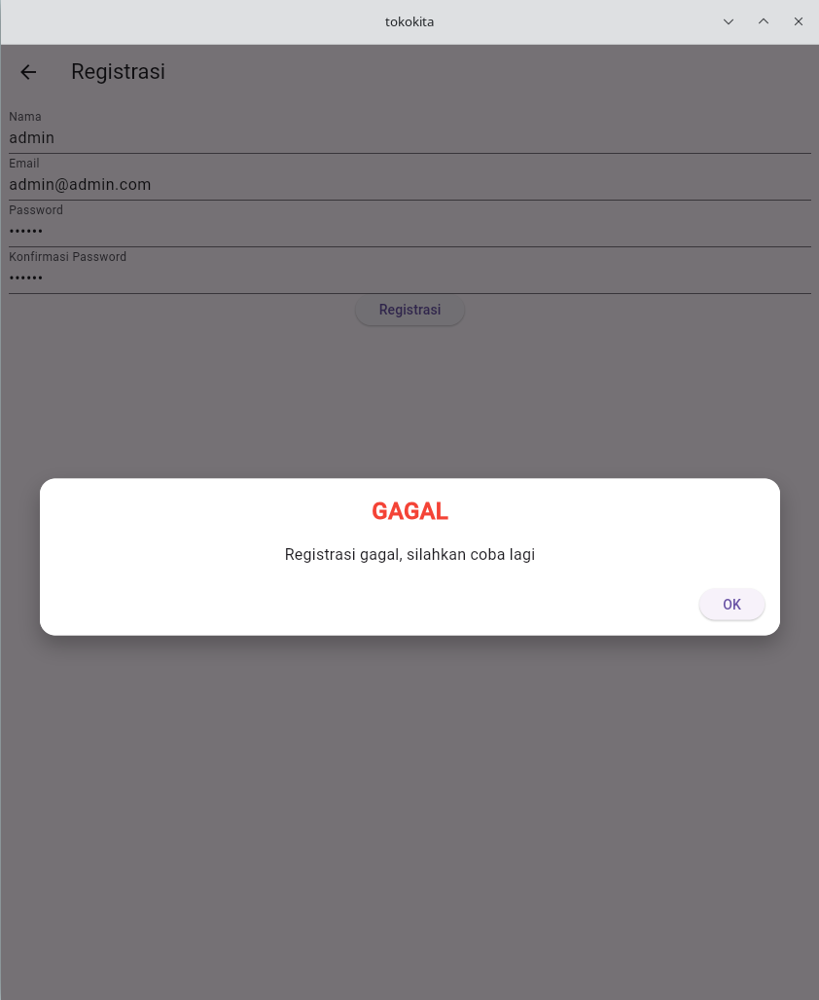
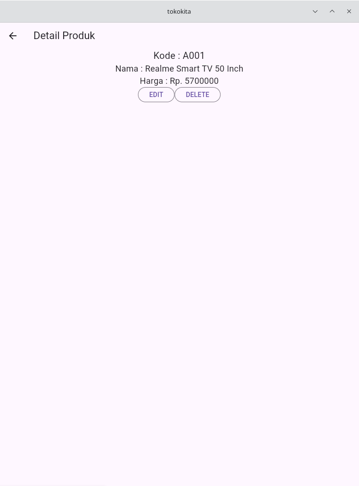
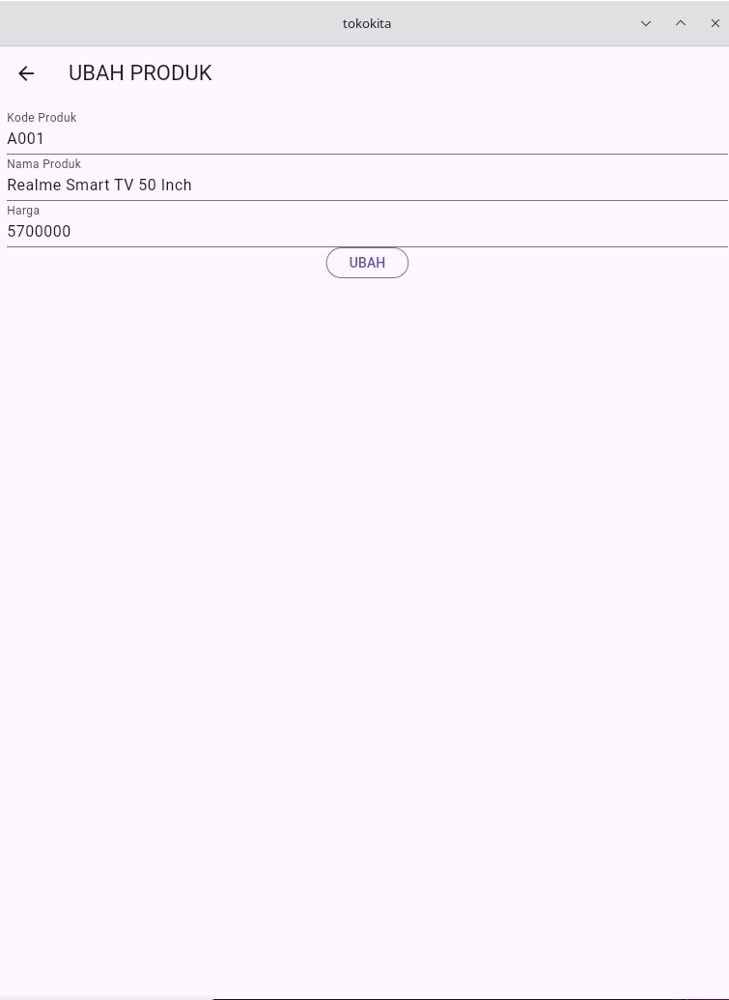

# ##################################################
# LAPORAN PRAKTIKUM PEMROGRAMAN MOBILE - PERTEMUAN 4
# ##################################################

# Toko Kita: Aplikasi Mobile CRUD Produk dengan REST API CodeIgniter 4 (Dasar Koneksi & HTTP Request)

| | |
|---|---|
| **Nama** | Fariz Rahman Syahida |
| **NIM** | H1D024008 |
| **Shift** | Awal F / Akhir C |
| **Praktikum** | Pemrograman Mobile (Pertemuan 4) |

## Deskripsi
Praktikum Pertemuan 4 berfokus pada pembangunan fondasi awal aplikasi mobile Flutter **Toko Kita** agar dapat terhubung dengan REST API backend berbasis CodeIgniter 4 (`ci4-api`). Mahasiswa mempelajari cara melakukan koneksi jaringan dari emulator ke server lokal, menangani exception jaringan, serta mengimplementasikan operasi CRUD dasar secara *synchronous/asynchronous* menggunakan package `http` dan setState standar.

```
Aplikasi Flutter (tokokita) → HTTP/JSON → CodeIgniter 4 (ci4-api) → MariaDB (toko_api)
```

## Fitur (Pertemuan 4)
- Koneksi jaringan dasar antara Flutter dan backend API lokal (mengatasi *SocketException* & *URL parsing*).
- Form Registrasi akun baru.
- Form Login dan penyimpanan sesi token menggunakan helper.
- Menampilkan daftar produk (*List Produk*) dari database melalui endpoint API.
- Form Tambah, Detail, Ubah, dan Hapus produk secara langsung.
- Fitur Logout sederhana.

## Teknologi (Pertemuan 4)
* **Frontend:** Flutter, Dart, package `http`
* **Backend:** CodeIgniter 4, PHP 8.5
* **Database:** MariaDB
* **Web Server:** Apache (Arch Linux)

## Endpoint API Utama
| Method | Endpoint | Fungsi |
|---|---|---|
| POST | `/registrasi` | Registrasi akun baru |
| POST | `/login` | Autentikasi login & mengambil token |
| GET | `/produk` | Mengambil seluruh data produk |
| POST | `/produk` | Menambahkan data produk baru |
| GET | `/produk/{id}` | Menampilkan detail produk |
| PUT | `/produk/{id}` | Mengubah data produk |
| DELETE | `/produk/{id}` | Menghapus data produk |

---

# ##################################################
# LAPORAN PRAKTIKUM PEMROGRAMAN MOBILE - PERTEMUAN 5
# ##################################################

# Toko Kita: Implementasi State Management BLoC & Pemisahan Arsitektur

| | |
|---|---|
| **Nama** | Fariz Rahman Syahida |
| **NIM** | H1D024008 |
| **Shift** | Awal F / Akhir C |
| **Praktikum** | Pemrograman Mobile (Pertemuan 5) |

## Deskripsi
Pada **Pertemuan 5**, fokus praktikum ditingkatkan ke arah penerapan arsitektur perangkat lunak yang lebih profesional, yaitu **State Management menggunakan BLoC (Business Logic Component)**. Seluruh logika pemanggilan API, pengelolaan state *loading*, *success*, dan *error* dipisahkan dari tampilan UI. Selain itu, ditambahkan penanganan dialog interaktif untuk skenario sukses maupun gagal (seperti validasi gagal login, gagal registrasi, dan konfirmasi aksi).

```
Flutter UI (Widgets) ⇄ BLoC Events/States ⇄ API Helpers ⇄ CodeIgniter 4 Backend
```

## Fitur & Pembaruan (Pertemuan 5)
- Migrasi logika state UI ke dalam arsitektur **BLoC** (`registrasi_bloc`, `login_bloc`, `logout_bloc`, dan `produk_bloc`).
- Penanganan skenario gagal login dan registrasi menggunakan komponen `WarningDialog`.
- Penanganan notifikasi sukses menggunakan komponen `SuccessDialog`.
- Pemisahan total antara struktur *Business Logic* dan *User Interface* agar kode lebih bersih dan teruji.

## Struktur Project Keseluruhan (Pertemuan 4 & 5)
```
tokokita/
├── lib/
│   ├── main.dart
│   ├── bloc/
│   │   ├── login_bloc.dart
│   │   ├── logout_bloc.dart
│   │   ├── produk_bloc.dart
│   │   └── registrasi_bloc.dart
│   ├── helpers/
│   │   ├── api.dart
│   │   ├── api_url.dart
│   │   ├── app_exception.dart
│   │   └── user_info.dart
│   ├── model/
│   │   ├── login.dart
│   │   ├── produk.dart
│   │   └── registrasi.dart
│   ├── ui/
│   │   ├── login_page.dart
│   │   ├── registrasi_page.dart
│   │   ├── produk_page.dart
│   │   ├── produk_form.dart
│   │   └── produk_detail.dart
│   └── widget/
│       ├── success_dialog.dart
│       └── warning_dialog.dart
└── docs/                     ← Kumpulan screenshot bukti uji coba
```

## Dokumentasi Tampilan & Skenario Pengujian (Screenshot)

Berikut adalah lampiran visual dari seluruh skenario pengujian aplikasi (baik kondisi berhasil maupun gagal):

**1. Halaman Login**


**2. Skenario Login Gagal (Peringatan)**


**3. Skenario Registrasi Berhasil**


**4. Skenario Registrasi Gagal**


**5. Halaman List Produk**


**6. Form Tambah Produk**


**7. Halaman Detail Produk**


**8. Form Ubah/Edit Produk**


---

## Kesimpulan Umum

* **Pertemuan 4** memberikan dasar yang kuat dalam memahami cara kerja komunikasi data secara jaringan antara aplikasi seluler Flutter dengan server backend lokal (CodeIgniter 4 & MariaDB) menggunakan HTTP request dasar.
* **Pertemuan 5** menyempurnakan aplikasi tersebut dengan menerapkan prinsip arsitektur profesional menggunakan pola **BLoC**, sehingga pemisahan tugas antara pemrosesan data (logika bisnis) dan tampilan antarmuka menjadi terstruktur dengan baik serta siap untuk pengembangan skala besar.