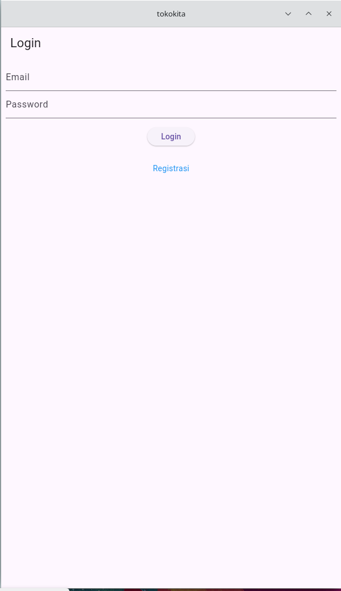
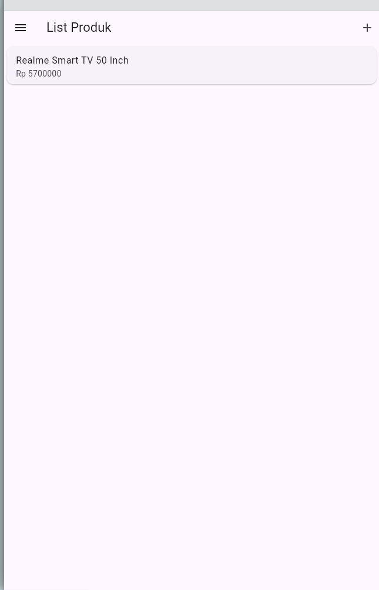
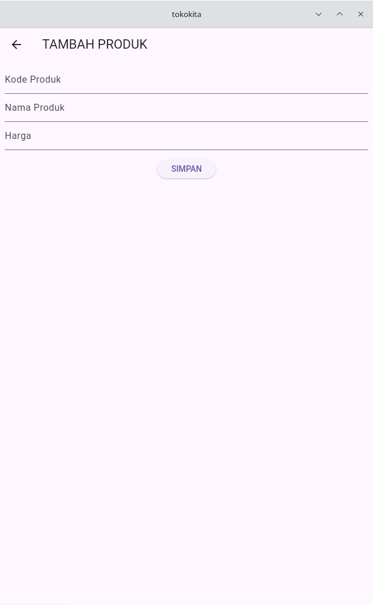

# Toko Kita: Aplikasi Mobile CRUD Produk dengan REST API CodeIgniter 4

| | |
|---|---|
| **Nama** | Fariz Rahman Syahida |
| **NIM** | H1D024008 |
| **Shift** | Awal F / Akhir C |
| **Praktikum** | Pemrograman Mobile |

## Deskripsi

Aplikasi mobile Flutter bernama **Toko Kita** yang terhubung ke REST API berbasis CodeIgniter 4. Pengguna dapat registrasi, login, dan mengelola data produk (tambah, lihat, ubah, hapus) yang tersimpan di MariaDB melalui API.

```
Aplikasi Flutter (tokokita) → HTTP/JSON → CodeIgniter 4 (ci4-api) → MariaDB (toko_api)
```

## Fitur

- Registrasi akun baru
- Login dan menerima token dari API
- List produk dari API, dengan tarik untuk memuat ulang
- Tambah produk (`POST /produk`)
- Detail produk dengan tombol edit dan hapus
- Ubah produk (`PUT /produk/{id}`)
- Hapus produk dengan konfirmasi (`DELETE /produk/{id}`)
- Logout dari side menu

## Teknologi

| Bagian | Teknologi |
|---|---|
| Frontend | Flutter, Dart, package `http` |
| Backend | CodeIgniter 4, PHP 8.5 |
| Database | MariaDB |
| Web server | Apache (Arch Linux) |
| Editor | Cursor |

## Struktur Project

```
tokokita/
├── lib/
│   ├── main.dart
│   ├── model/
│   │   ├── login.dart
│   │   ├── produk.dart
│   │   └── registrasi.dart
│   └── ui/
│       ├── api.dart
│       ├── login_page.dart
│       ├── registrasi_page.dart
│       ├── produk_page.dart
│       ├── produk_form.dart
│       └── produk_detail.dart
└── docs/                 ← screenshot aplikasi
```

## Endpoint API

| Method | Endpoint | Fungsi |
|---|---|---|
| POST | `/registrasi` | Registrasi akun |
| POST | `/login` | Login, mengembalikan token |
| GET | `/produk` | Daftar semua produk |
| POST | `/produk` | Tambah produk |
| GET | `/produk/{id}` | Detail produk |
| PUT | `/produk/{id}` | Ubah produk |
| DELETE | `/produk/{id}` | Hapus produk |

## Cara Menjalankan

**1. Jalankan backend**

```bash
sudo systemctl start mariadb httpd
```

**2. Jalankan aplikasi Flutter**

```bash
cd tokokita
flutter pub get
flutter run
```

Untuk emulator Android, jalankan `adb reverse tcp:80 tcp:80` agar emulator dapat mengakses Apache di laptop, dan pastikan `lib/ui/api.dart` berisi `baseUrl` yang sesuai.

**Akun uji:** `admin@admin.com` / `admin`

## Tampilan Aplikasi

**Halaman Login**


**List Produk**


**Tambah Produk**


**Detail Produk**


**Ubah Produk**


## Kesimpulan

Praktikum ini memberikan pemahaman tentang cara menghubungkan aplikasi Flutter dengan REST API. Mahasiswa mempelajari pemanggilan HTTP (GET, POST, PUT, DELETE) menggunakan package `http`, konversi JSON ke model Dart, dan pengelolaan state dengan `setState`. Selain itu, mahasiswa juga membangun API CRUD dengan CodeIgniter 4 dan menguji endpoint-nya. Tantangan utama adalah konfigurasi jaringan antara emulator Android dan server lokal, yang diatasi dengan `adb reverse`.